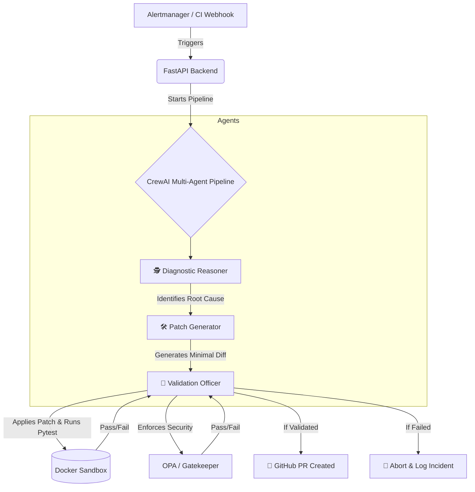
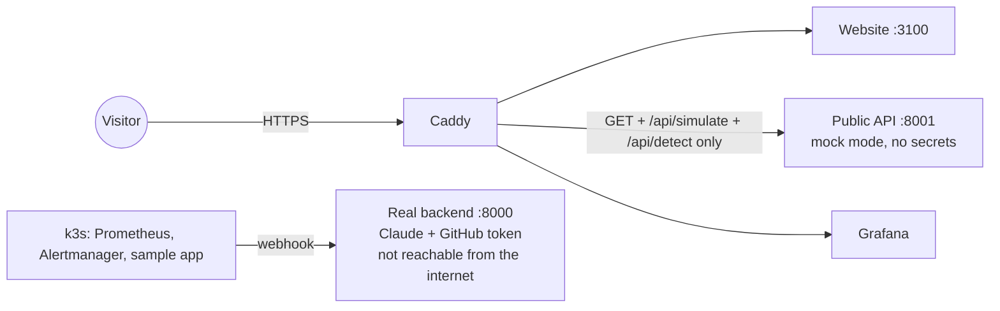

# 👻 GhostOps

GhostOps is an autonomous AIOps platform that acts as an AI-driven Site Reliability Engineer (SRE). Instead of just alerting humans when something breaks, GhostOps detects real incidents, diagnoses the root cause, writes a code fix, validates the patch in a secure sandbox, and opens a GitHub Pull Request—all autonomously.

**Live demo:** https://ghostops.140-245-208-207.sslip.io (public, mock-mode AI, safe to click) · Grafana: https://grafana.140-245-208-207.sslip.io

## 🚀 Project Overview

When an incident occurs (e.g., a memory leak or a CI test failure), GhostOps springs into action:
1. **Detection:** Prometheus and Alertmanager detect anomalies in the cluster and fire webhooks to the GhostOps FastAPI backend.
2. **Diagnosis:** A multi-agent AI pipeline built on [CrewAI](https://github.com/joaomdmoura/crewAI) and powered by Claude (Anthropic) analyzes the failure context (logs, metrics, source code, and past incidents).
3. **Remediation:** A minimal code fix (git patch) is generated.
4. **Validation:** The patch is strictly validated in an isolated, ephemeral Docker sandbox to ensure tests pass and it complies with OPA (Open Policy Agent) security policies.
5. **Deployment:** If (and only if) validation passes, a real GitHub PR is opened for human review, complete with an explanation and evidence.

---

## 🏗️ Architecture & Pipeline Flow

The core of GhostOps is a sequential 3-agent pipeline orchestrated by CrewAI:



---

## 🛠️ Tech Stack

*   **Infrastructure:** Kubernetes (Kind), Terraform, Docker
*   **Observability:** Prometheus, Alertmanager, Grafana, Jaeger / OpenTelemetry
*   **Security & Policy:** HashiCorp Vault (Secrets), OPA / Gatekeeper (Policy Enforcement)
*   **Chaos Engineering:** Chaos Mesh
*   **Backend & Orchestration:** Python, FastAPI, CrewAI
*   **LLM Provider:** Claude API (`anthropic/claude-sonnet-5-5` via LiteLLM)
*   **Continuous Deployment:** ArgoCD
*   **Web Dashboard:** Next.js, React Three Fiber, Tailwind CSS

---

## 💻 Setup & Installation

To run GhostOps locally, you'll need Docker, `kind`, `kubectl`, `helm`, and `python3`.

1. **Spin up the Cluster:**
   ```bash
   kind create cluster --config infra/kind/kind-config.yaml
   ```
2. **Apply Infrastructure (Monitoring, OPA, Chaos Mesh):**
   ```bash
   kubectl apply -f infra/k8s/monitoring/
   kubectl apply -f infra/k8s/gatekeeper/
   helm repo add chaos-mesh https://charts.chaos-mesh.org
   helm install chaos-mesh chaos-mesh/chaos-mesh -n chaos-mesh --create-namespace --version 2.7.0
   ```
3. **Set Up the Backend:**
   ```bash
   python3 -m venv venv
   source venv/bin/activate
   pip install -r backend/requirements.txt -r agents/requirements.txt
   ```
4. **Environment Variables:**
   Ensure you have a `.env` file or Vault running with your `ANTHROPIC_API_KEY` and `GITHUB_TOKEN`.
5. **Run the API & Agents:**
   ```bash
   uvicorn backend.main:app --host 0.0.0.0 --port 8000
   ```
   *(Ensure port-forwards for Jaeger (4317), Prometheus (9090), and Grafana (3000) are active if viewing telemetry).*

---

## ☁️ Cloud Deployment (Oracle Cloud)

GhostOps runs on one Oracle Cloud Arm VM (Ubuntu 24.04, 4 OCPU, 24 GB; inside the Always Free allowance).
Everything is set up by two scripts in `deploy/oracle/`:

```bash
bash deploy/oracle/bootstrap.sh          # once: opens 80/443 in the VM firewall, installs Docker, Caddy, Node 22
cp deploy/oracle/env.example .env && nano .env   # ANTHROPIC_API_KEY, GITHUB_TOKEN, ...
bash deploy/oracle/setup.sh              # k3s + monitoring + sample app + both backends + website + HTTPS
```

Also open ports 80 and 443 in the VM's Oracle network security list. `setup.sh` is safe to re-run after a `git pull`.



| What | Where | Notes |
|---|---|---|
| Website | `https://ghostops.<ip>.sslip.io` | Next.js, `next start` as a systemd service |
| Public API | `https://api-ghostops.<ip>.sslip.io` | **Mock mode**: no Claude call, no PR; `ANTHROPIC_API_KEY` and `GITHUB_TOKEN` are forced empty; its own database |
| Real backend | `127.0.0.1:8000` on the VM | Real Claude pipeline, opens real PRs. Port 8000 is closed to the internet; reach it with `ssh -L 8000:127.0.0.1:8000 ubuntu@<ip>` |
| Grafana | `https://grafana.<ip>.sslip.io` | Viewer access for visitors |

Caddy refuses `/metrics` and `/webhook/*`, and every non-GET request except `/api/simulate` and `/api/detect`,
so the kill switch, `/api/live/*` and feedback sync are not reachable from the internet. HTTPS certificates are
issued automatically for `<ip>.sslip.io` names, so no domain is needed.

---

## 🎬 Presentation Demo

`scripts/demo.sh` drives the whole demo:

```bash
./scripts/demo.sh check      # pre-flight: cluster, keys, clean git tree
./scripts/demo.sh up         # dashboards: Grafana :3000, Prometheus :9090, Jaeger :16686, Chaos Mesh :2333
./scripts/demo.sh backend    # GhostOps backend (own terminal, keep it open)
./scripts/demo.sh tests      # each test group separately, with a PASS banner
./scripts/demo.sh leak       # scenario 1 live: leak -> alert -> AI fix -> PR  (--direct: no cluster)
./scripts/demo.sh ci         # scenario 2: CI test failure -> AI fix -> PR
./scripts/demo.sh reset      # restart the sample app between runs
```

---

## 🧪 Offline Mode (no API key)

Set `GHOSTOPS_MOCK_LLM=1` and the Diagnostic Reasoner and Patch Generator are replaced by
deterministic rules (`agents/mock_llm.py`). Every patch still goes through the **real** OPA policy
check and Docker sandbox, so the demo, dashboard and tests all work without Claude credits.
Mock runs never open a PR unless `GHOSTOPS_MOCK_CREATE_PR=1` is also set.

```bash
GHOSTOPS_MOCK_LLM=1 python -m agents.crew a1   # or b1, c4
GHOSTOPS_MOCK_LLM=1 uvicorn backend.main:app --port 8000
```

`GHOSTOPS_DB_PATH` points the knowledge base somewhere other than `agents/data/incidents.db`.

## 🌐 Web Dashboard

`web/` is a Next.js + React Three Fiber site. It lets you trigger incidents and watch them
being fixed live in 3D, and also has the detector lab, the use-case catalogue and the
knowledge base. See [`web/README.md`](web/README.md).

### API

| Endpoint | Purpose |
|---|---|
| `GET /api/status` | Whether mock mode is on and whether a pipeline is running |
| `GET /api/scenarios` · `POST /api/simulate` | List demo scenarios / start one in the background |
| `GET /api/runs` · `/api/runs/{id}` · `/api/runs/{id}/events` | Follow a run (polling or Server-Sent Events) |
| `POST /api/detect` · `GET /api/usecases` | Run the deterministic detectors / the 17-use-case catalogue |
| `GET /api/incidents/summary` · `/recent` · `/timeseries` · `/{id}` | Knowledge-base reads |
| `GET /api/incidents/feedback` · `POST /api/incidents/feedback/sync` | Human acceptance of GhostOps' PRs, synced from GitHub |
| `GET /api/live/status` · `POST /api/live/leak` · `POST /api/live/canary` | Real incidents on the cluster (B1 leak, C1 bad release) |
| `GET /api/activity` | What GhostOps is doing right now (drives the hero visuals) |

### Use-case coverage

17 use cases are catalogued. 16 have a deterministic detector (`agents/detectors/`; C4 needs none, the failing test run is the alert). **Four are fixed end to end**; the other 13 are detected and diagnosed, and a human does the fix:

| Use case | Trigger | Remediation |
|---|---|---|
| **B1** memory leak | `SampleAppHighMemory` (memory > 80% of limit for 30 s) | AI patch → OPA → Docker sandbox → PR |
| **C4** CI test failure | failing pytest run | AI patch → OPA → Docker sandbox → PR |
| **A1** unhandled exception | traceback | AI patch (null-safety guard) → OPA → sandbox → PR |
| **C1** canary regression | `SampleAppHighErrorRate` (> 20% 5xx per release for 30 s) | diagnose from rollout history → `kubectl rollout undo` → verify with real traffic (no PR) |

## 🔴 Live Mode (real cluster)

With the kind cluster running and the backend listening on `0.0.0.0:8000` (so Alertmanager can reach it),
the dashboard's **LIVE** buttons create real incidents:

* **memory leak**: leaks memory in the running sample-app pod through the Kubernetes API, Prometheus fires
  `SampleAppHighMemory`, and Alertmanager's real webhook starts the pipeline;
* **bad release**: ships a release that fails half of its checkouts, drives real traffic, Prometheus fires
  `SampleAppHighErrorRate`, and GhostOps rolls it back and verifies recovery.

Any real alert (Chaos Mesh, the demo script) shows up live on the dashboard on its own, and the hero hologram
and background follow what GhostOps is actually doing (`GET /api/activity`).

## 🔁 Feedback Loop

`agents/feedback.py` reads what reviewers did with GhostOps' PRs from GitHub (merged, closed, open, or
superseded when labelled `duplicate`) into the knowledge base. The dashboard shows the human acceptance
rate, and every new diagnosis receives past incidents together with the reviewer's decision.

## 🛡️ Safety & Trust

A fix only reaches a human after it clears every gate, and every step is recorded.

* **Prompt-injection shield** (`agents/shield.py`): logs and metrics are untrusted; instructions hidden in them never reach the model.
* **Three gates before a PR:** the OPA file allowlist, the Docker sandbox (the app's tests), and the **blast-radius gate** (how much the patch changes).
* **Regression test per fix**, proven to fail before the patch and pass after it, plus **counterfactual replay** of the incident's real traffic where the app is replayable.
* **Risk score and graduated autonomy:** small, well-tested, high-confidence fixes may be auto-merged to staging; the rest wait for a person.
* **Signed evidence:** each validated fix carries an Ed25519-signed bundle (diff hash, gate results, sandbox output hash, versions).
* **Canary of the fix** and **post-merge / production verification** (real MTTR).
* **Kill switch and tamper-evident audit trail:** every decision is hash-chained in the knowledge base.
* **Learning:** the fix library reuses fixes humans merged (no LLM call), the feedback loop records reviewer decisions, and a **postmortem** is written for every incident.
* **Incident deduplication and correlation:** repeats and related alerts join one incident (incidents silent for 2 h expire), and an **incident cost meter** shows what each run cost.

The model is Claude Sonnet 5.5 by default; set `CLAUDE_MODEL` in `.env` to use another.

## ✅ Tests

| Suite | What | Count |
|---|---|---|
| `pytest` | agents, detectors, backend, live mode, C1, feedback loop, PR flow against a real git repo, end-to-end runs through the real Docker sandbox | 530 |
| Rego (`conftest verify`) | the OPA allowlist, including path traversal | 10 |
| Vitest | website logic: diff view, pipeline states, replay, charts, API client, activity feed | 26 |
| e2e (`web/e2e/smoke.mjs`) | Chrome against the built site and a real backend: a C4 run validated by the sandbox, palette, detector lab, replay | 1 flow |

Backend source coverage is about 90%. CI runs all of it on every pull request.

---

## 🎯 Triggering a Demo Incident

GhostOps is designed to respond to real failures. You can trigger incidents in two ways:

1. **Manual Endpoint Trigger:**
   Hit the sample application's leak endpoint repeatedly to simulate a memory leak:
   ```bash
   for i in {1..10}; do curl http://localhost:5000/leak; done
   ```
   This triggers Alertmanager based on Prometheus memory metrics.

2. **Chaos Mesh Injection:**
   Deploy the predefined `StressChaos` experiment to automatically inject high memory consumption in the cluster, forcing the pipeline to react dynamically.

---

## 🏆 Real Example Resolutions

GhostOps has been proven to resolve complex issues end-to-end, locally and on the Oracle VM (Claude Sonnet 5.5). Here are two early examples of the AI pipeline diagnosing a problem and submitting a correct, validated fix (the PRs are closed on purpose, because merging one removes the bug the demo needs):

*   **Example 1 (Memory Leak):** 
    Detected a growing cache issue in `app.py`. The pipeline identified the unbounded growth, generated a fix to implement an LRU cache or max-size limit, validated it, and opened a PR. 
    👉 [**View PR #3**](https://github.com/likith1231/ghostops/pull/3)

*   **Example 2 (CI Test Failure):**
    A logic defect in `math_utils.py` (using `+` instead of `*`) caused `pytest` to fail in CI. GhostOps intercepted the failure, isolated the bug to the specific function, fixed the mathematical operator, validated it against the OPA allowlist, and opened a PR.
    👉 [**View PR #4**](https://github.com/likith1231/ghostops/pull/4)

---

## ⚠️ Known Limitations

GhostOps is currently a localized Proof of Concept and is **not yet production-hardened**:
*   **Single machine:** The cluster, both backends and the website share one VM (or your laptop's `kind` cluster). There is no high availability.
*   **No API authentication:** `/api/simulate` and `/api/live/*` have no login. On the Oracle VM the real backend is not exposed and the public API is mock-mode and restricted by Caddy; when you run it yourself, keep it on a trusted network.
*   **Vault in Dev Mode:** HashiCorp Vault is running in `-dev` mode with HTTP. In production, TLS and proper auto-unseal must be configured.
*   **Manual OPA Updates:** The OPA Gatekeeper allowlist (`allowlist.rego`) strictly dictates which files the AI is permitted to patch. Currently, new authorized files (like `app.py` or `math_utils.py`) must be manually added to the policy.
*   **API Rate Limits:** The multi-agent pipeline is token-heavy and reliant on the Claude API limits. Extensive debugging sessions may trigger rate-limiting errors (`429 Resource Exhausted`). Mock mode (`GHOSTOPS_MOCK_LLM=1`) runs everything else without a key.
*   **Sample Workloads:** The end-to-end use cases run against the bundled sample app; the other 13 catalogued use cases (A2-A5, B2-B6, C2, C3, C5, C6) have detectors but no remediation yet. Most are infrastructure changes (limits, Services, NetworkPolicies, image tags) that a pytest sandbox cannot validate, so they are left to a human by design.
